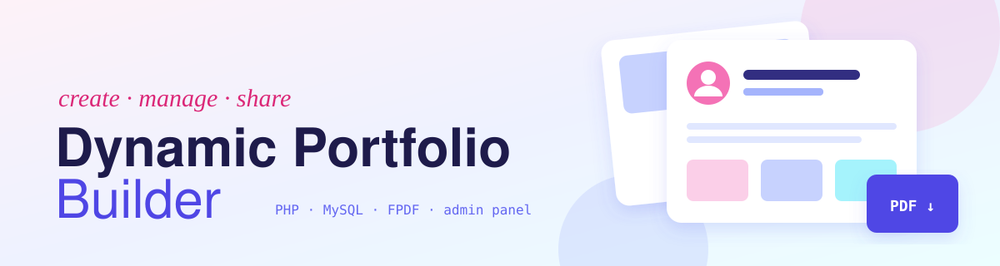

<p align="center">
  
</p>

# 🌟 Dynamic Portfolio Builder 🌟

Welcome to the **Dynamic Portfolio Builder**! This project is a web-based application that allows users to create, manage, and share professional portfolios. It also includes an admin panel for managing users, portfolios, and feedback. 🚀

---

## 📂 Project Structure

Here's an overview of the folder structure:

```
Dynamic-Portfolio-Builder/
├── index.html                # User login page
├── register.html             # User registration page
├── portfolio.html            # Portfolio creation page
├── portfolio_db.sql          # Database schema
├── Readme.md                 # Project documentation
├── admin/                    # Admin panel
│   ├── create_admin.php      # Admin account creation (⚠️ Unsecured)
│   ├── dashboard.php         # Admin dashboard
│   ├── index.html            # Admin login page
│   ├── css/                  # Admin-specific styles
│   └── php/                  # Admin backend scripts
├── css/                      # Global styles
│   ├── login_reg.css         # Login and registration styles
│   ├── style4history.css     # History page styles
│   └── styles.css            # General styles
├── db/                       # Database connection
│   └── db.php                # Database configuration
├── fpdf/                     # PDF generation library
│   ├── fpdf.php              # Core FPDF library
│   └── font/                 # Fonts for PDF generation
├── gif/                      # Animated GIFs for UI
├── js/                       # JavaScript files
│   └── scripts.js            # Frontend interactivity
├── php/                      # User backend scripts
│   ├── dashboard.php         # User dashboard
│   ├── edit_portfolio.php    # Edit portfolio
│   ├── generate_pdf.php      # Generate portfolio PDF
│   ├── history.php           # Portfolio history
│   ├── login.php             # User login
│   ├── register.php          # User registration
│   ├── submit_feedback.php   # Submit feedback
│   └── ...                   # Other backend scripts
└── uploads/                  # Uploaded files (e.g., user photos)
```

---

## 🚀 Features

### 🧑‍💻 User Features

- **Login & Registration**: Secure user authentication with hashed passwords.
- **Portfolio Creation**: Create professional portfolios with personal details, skills, and work experience.
- **PDF Generation**: Export portfolios as PDFs using the FPDF library.
- **Portfolio History**: View, edit, and delete previously created portfolios.
- **Feedback Submission**: Share feedback with the admin team.

### 🔑 Admin Features

- **Admin Dashboard**: View system stats and recent activity.
- **User Management**: Ban/unban users and manage accounts.
- **Portfolio Management**: View, filter, and delete user portfolios.
- **Feedback Management**: Review and respond to user feedback.
- **Analytics Dashboard**: Visualize user and portfolio growth with charts.

---

## 🛠️ Setup Instructions

### 1️⃣ Prerequisites

- PHP 7.4 or higher
- MySQL database
- A web server (e.g., Apache or Nginx)

### 2️⃣ Installation

1. Clone the repository:

   ```bash
   git clone https://github.com/your-repo/Dynamic-Portfolio-Builder.git
   cd Dynamic-Portfolio-Builder
   ```

2. Import the database:

   - Open `phpMyAdmin` or your preferred MySQL client.
   - Create a database named `portfolio_db`.
   - Import the portfolio_db.sql file.

3. Configure the database connection:

   - Edit db.php and update the following:
     ```php
     $servername = "localhost";
     $username = "root";
     $password = "";
     $dbname = "portfolio_db";
     ```

4. Start the server:

   ```bash
   php -S localhost:8000
   ```

5. Access the application:
   - User login: [http://localhost:8000/index.html](http://localhost:8000/index.html)
   - Admin login: [http://localhost:8000/admin/index.html](http://localhost:8000/admin/index.html)

---

## ⚠️ Security Warnings

- **Unsecured Admin Creation**: The create_admin.php file allows anyone to create admin accounts without authentication. **Delete this file after initial setup!** ❌
- **CSRF Protection**: Ensure CSRF tokens are implemented and verified in all forms.
- **Input Validation**: Validate and sanitize all user inputs to prevent SQL injection and XSS attacks.

---


## 📜 License

This project is licensed under the terms outlined in the [LICENSE](./Licence) file located in the root directory. Please refer to it for detailed information about usage, distribution, and attribution requirements.

---

## 🤝 Contributing

We welcome contributions! Here's how you can help:

1. Fork the repository.
2. Create a new branch: `git checkout -b feature-name`.
3. Commit your changes: `git commit -m 'Add feature'`.
4. Push to the branch: `git push origin feature-name`.
5. Submit a pull request. 🎉

---

## 📧 Contact

For any questions or feedback, feel free to reach out:

- **Facebook**: [Azizul Abedin Azmi](https://facebook.com/azizul.abedin.azmi/)
- **GitHub**: [Azizul Abedin Azmi](https://github.com/azizulabedinazmi/)

---

Thank you for using **Dynamic Portfolio Builder**! 🌟
